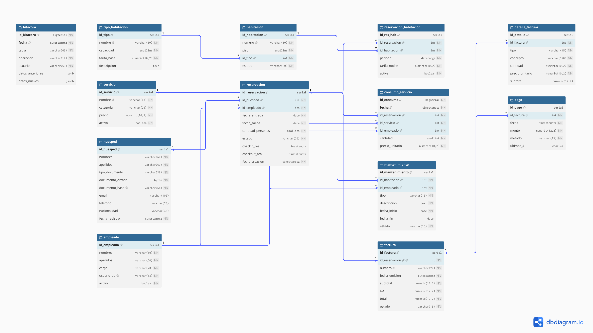

<div class="portada" markdown="1">

**Universidad de El Salvador**<br>
Facultad Multidisciplinaria de Occidente<br>
Departamento de Ingeniería y Arquitectura<br>
Ingeniería en Desarrollo de Software

**Administración de Bases de Datos — Ciclo II 2026**

# Proyecto Final
## Sistema de Administración Hotelera (Reservaciones y Servicios)
### Escenario 7 — Implementación en PostgreSQL 18

| Integrante | Carné | Área principal |
|------------|-------|----------------|
| Luis Antonio Ruiz Duran | RD20014 | Diseño del modelo ER e implementación |
| Wendy Carolina Aristondo Soto | AS21020 | Almacenamiento, rendimiento y mantenimiento |
| Joel Isaias Garcia Torres | GT14001 | Respaldos, recuperación y alta disponibilidad |
| Adriana Vanessa Rivera de Rivera | RR20075 | Seguridad, monitoreo y alertas |

Docente: Jonathan Wilfredo Rodriguez Ramos<br>
Fecha de entrega: 18 de noviembre de 2026

</div>

## Índice

1. Descripción del proyecto
2. Diagrama entidad-relación
3. Decisiones técnicas del diseño e implementación
4. Rendimiento y optimización
5. Manejo del espacio en disco y mantenimiento
6. Respaldos, recuperación y alta disponibilidad
7. Medidas de seguridad
8. Monitoreo y alertas
9. Validación
10. Retos enfrentados y soluciones aplicadas
11. Conclusiones


---

## 1. Descripción del proyecto

Un hotel de tamaño mediano administra sus reservaciones, la ocupación de habitaciones, los datos de los huéspedes y la facturación con hojas de cálculo y formularios físicos. Esto provoca **sobre-reservaciones, errores en cobros y dificultad para generar reportes**. El proyecto diseña, implementa y administra una base de datos en PostgreSQL 18 que resuelve estos problemas y cubre los siete requerimientos del escenario:

| Requerimiento | Cómo se resuelve |
|---------------|------------------|
| 1. Habitaciones | `habitacion` + catálogo `tipo_habitacion` (capacidad, tarifa); estado `disponible / ocupada / mantenimiento / fuera_servicio` actualizado automáticamente |
| 2. Huéspedes | `huesped` con documento **cifrado**; historial en la vista `vw_historial_huesped` |
| 3. Reservaciones | `reservacion` + `reservacion_habitacion` (una reserva puede incluir varias habitaciones); estados `pendiente → confirmada → en_curso → finalizada` / `cancelada` / `no_show` |
| 4. Disponibilidad y servicios | Restricción `EXCLUDE` que **impide en el motor** reservar dos veces una habitación en fechas que se traslapan; `fn_habitaciones_disponibles()`; `consumo_servicio` registra restaurante, lavandería, transporte, spa, etc. |
| 5. Facturas | `fn_generar_factura()` (se ejecuta en el check-out): una línea por habitación y por servicio, IVA 13 %; `pago` admite pagos parciales y mixtos |
| 6. Consultas | `vw_ocupacion_actual`, `fn_reporte_ocupacion()`, `vw_ingresos_mensuales`, `vw_servicios_mas_utilizados`, `vw_facturas_pendientes`, `mv_resumen_mensual` |
| 7. Usuarios internos | Roles de PostgreSQL `rol_administrador`, `rol_recepcionista`, `rol_mantenimiento` y `rol_gerente`, con un usuario de inicio de sesión por empleado y seguridad a nivel de fila |

**Infraestructura:**

- Docker Compose levanta un servidor **primario**, una **réplica en streaming** (hot standby) y, opcionalmente, **pgAdmin 4**.
- Toda la base se crea con scripts SQL versionados (`sql/00…08`), que se ejecutan automáticamente al iniciar el primer contenedor.

## 2. Diagrama entidad-relación



**13 tablas en el esquema `hotel`:**

- **Catálogos:** `tipo_habitacion`, `habitacion`, `servicio`.
- **Personas:** `huesped`, `empleado`.
- **Operación:** `reservacion`, `reservacion_habitacion`, `consumo_servicio`, `mantenimiento`.
- **Facturación:** `factura`, `detalle_factura`, `pago`.
- **Auditoría:** `bitacora`.

**Relaciones principales (1:N, salvo que se indique otra cosa):**

- `tipo_habitacion → habitacion`.
- `huesped → reservacion` y `empleado → reservacion` (quién registró la reserva).
- `reservacion ↔ habitacion` (N:M, resuelta con la tabla `reservacion_habitacion`).
- `reservacion → consumo_servicio ← servicio`, con el `empleado` que registró cada consumo.
- `habitacion → mantenimiento ← empleado`.
- `reservacion → factura`: **1:1**, garantizado con `UNIQUE (id_reservacion)`.
- `factura → detalle_factura` y `factura → pago`.

## 3. Decisiones técnicas del diseño e implementación

**3.1 Tabla puente con rango de fechas.** `reservacion_habitacion.periodo` es de tipo `daterange` `[entrada, salida)`; el extremo superior es abierto, así que una salida y una entrada el mismo día no se traslapan. La restricción

```sql
EXCLUDE USING gist (id_habitacion WITH =, periodo WITH &&) WHERE (activa)
```

hace que PostgreSQL **rechace cualquier sobre-reservación**, aunque dos recepcionistas intenten reservar la misma habitación al mismo tiempo. Una validación en la aplicación (consultar y luego insertar) no puede garantizar esto, porque entre la consulta y la inserción puede colarse otra transacción. Cuando una reserva se cancela o termina en *no-show*, un trigger marca `activa = false` y la habitación queda libre.

**3.2 Tarifa congelada.** `tarifa_noche` copia la tarifa vigente del tipo de habitación al momento de reservar. Un cambio de precios posterior no altera reservas ni facturas ya emitidas. Por la misma razón, `consumo_servicio.precio_unitario` guarda el precio del servicio en el momento del consumo.

**3.3 Lógica de negocio en la base de datos.** Las operaciones críticas son funciones y procedimientos `SECURITY DEFINER` con `search_path` fijo:

| Rutina | Qué valida o hace |
|--------|-------------------|
| `fn_crear_reservacion` | Capacidad suficiente y disponibilidad |
| `sp_check_in` | Fechas correctas y habitaciones disponibles; marca las habitaciones como ocupadas |
| `sp_check_out` | Libera las habitaciones y genera la factura |
| `sp_cancelar_reservacion` | Solo cancela reservas pendientes o confirmadas |
| `fn_generar_factura` | Arma el detalle (habitaciones y servicios) y calcula el IVA |

Los usuarios no pueden cambiar el `estado` de una reservación directamente, así que las reglas se cumplen aunque el cliente sea pgAdmin, una aplicación web o psql.

**3.4 Integridad declarativa.** Además de PK, FK, `UNIQUE` y `NOT NULL`, la base tiene restricciones `CHECK` para:

- los dominios de estado;
- `fecha_salida > fecha_entrada`;
- checkout solo después del checkin;
- `total = subtotal + iva` en la factura y `subtotal = cantidad × precio` en el detalle;
- que solo los descuentos lleven precio negativo;
- que un pago con tarjeta lleve exactamente 4 dígitos, y uno sin tarjeta, ninguno.

Por su parte, los triggers impiden:

- consumos en estadías que no están en curso;
- pagos mayores que el saldo o sobre facturas anuladas;
- iniciar un mantenimiento en una habitación ocupada.

Las FK usan `ON DELETE RESTRICT` (no se borra historia), salvo las tablas de detalle (`CASCADE`).

**3.5 Particionamiento.** `consumo_servicio` y `bitacora` crecen sin límite, así que se particionan por mes (`PARTITION BY RANGE (fecha)`). Por eso su clave primaria es compuesta (`id, fecha`): PostgreSQL exige que la clave de partición forme parte de la PK.

**3.6 Esquemas separados.**

| Esquema | Contenido |
|---------|-----------|
| `hotel` | Negocio |
| `seguridad` | Clave de cifrado; ningún rol de aplicación tiene acceso |
| `monitoreo` | Vistas de salud, alertas y registro de respaldos |
| `historico` | Bitácora archivada |

Todos los objetos pertenecen a `hotel_owner`, un rol sin inicio de sesión, así que ningún usuario puede alterar o borrar tablas.

**3.7 Datos de prueba.** Se cargan con las mismas funciones del negocio (reservar → check-in → consumos → check-out → pago), de modo que cumplen todas las reglas.

Registros por tabla: `tipo_habitacion` 10, `habitacion` 20, `servicio` 13, `huesped` 12, `empleado` 12, `reservacion` 18, `reservacion_habitacion` 19, `consumo_servicio` 38, `mantenimiento` 12, `factura` 10, `detalle_factura` 39, `pago` 11 y `bitacora` ~290 (generada automáticamente).

Incluyen estadías finalizadas, en curso y futuras, una cancelación, un *no-show*, un pago dividido y una factura con saldo pendiente.

## 4. Rendimiento y optimización

**Índices**, definidos en `sql/03_indices.sql`:

- Toda FK tiene índice.
- Índices **parciales** para los registros vivos (reservaciones activas, facturas pendientes, mantenimientos abiertos).
- **GIN con trigramas** (`pg_trgm`) para buscar huéspedes por nombre aproximado.
- **BRIN** sobre la fecha de la bitácora.
- El índice **GiST** de la restricción `EXCLUDE` también resuelve las consultas de disponibilidad.

**Medición.** `sql/rendimiento.sql` genera 300 000 consumos y 20 000 huéspedes dentro de una transacción que termina en `ROLLBACK` y muestra los planes con `EXPLAIN ANALYZE`:

| Prueba | Resultado |
|--------|-----------|
| Consumos de un mes (300 000 filas en total) | Solo se lee la partición de marzo (*partition pruning*): 11 ms |
| Búsqueda `ILIKE '%romero 1234%'` en 20 000 huéspedes | **0,5 ms** con GIN trigramas frente a **16,5 ms** sin índice (≈ 33×) |
| Disponibilidad de una habitación | *Index Only Scan* sobre el índice de la restricción `EXCLUDE` |
| Índice sobre la fecha (30 000 filas) | B-tree 656 kB frente a **BRIN 24 kB** (27× menor) |

**Configuración** (`docker/postgres/postgresql.conf`):

| Parámetro | Valor | Motivo |
|-----------|-------|--------|
| `shared_buffers` | 512 MB | ~25 % de la RAM |
| `effective_cache_size` | 1,5 GB | ~75 % de la RAM |
| `work_mem` | 8 MB | |
| `random_page_cost` | 1,1 | Almacenamiento SSD |
| `pg_stat_statements` | activo | Identificar las consultas más costosas (`monitoreo.vw_consultas_costosas`) |
| `log_min_duration_statement` | 500 ms | Registrar las consultas lentas |

La vista materializada `mv_resumen_mensual` sirve los reportes de gerencia sin cargar las tablas transaccionales. Se refresca cada noche con `REFRESH … CONCURRENTLY`, que no bloquea las lecturas.

## 5. Manejo del espacio en disco y mantenimiento

*El detalle completo, con la estimación de crecimiento, está en `docs/plan-mantenimiento.md`.*

**Tablespaces.** Hay tres ubicaciones físicas (en Docker, tres volúmenes independientes):

- `pg_default`: datos activos;
- `ts_indices`: índices de las tablas no particionadas;
- `ts_historico`: particiones antiguas y bitácora archivada.

**Crecimiento estimado.** Unos 27 MB por año con 20 habitaciones. La bitácora es el 75 % de ese crecimiento, por lo que tiene una política de retención de 24 meses en línea.

**Ciclo de vida de los datos.** La función `fn_mantenimiento_diario()`:

1. crea con anticipación las particiones de los próximos 3 meses;
2. mueve a `ts_historico` los consumos con más de 12 meses;
3. desvincula (`DETACH`) la bitácora con más de 24 meses y la pasa al esquema `historico`;
4. marca como *no-show* las reservas cuya entrada pasó sin check-in;
5. refresca la vista materializada.

Archivar un mes completo es una operación de metadatos: no hay `DELETE` masivo ni espacio muerto que limpiar después.

**Otras técnicas de ahorro de espacio:**

- `fillfactor` de 85 y 90 en las tablas con muchas actualizaciones de estado (actualizaciones HOT, sin nuevas entradas de índice);
- `wal_compression = lz4`;
- WAL archivado comprimido con gzip: un segmento de 16 MB casi vacío ocupa unos 16 KB;
- respaldos lógicos comprimidos;
- autovacuum ajustado, incluidas las tablas de solo inserción;
- logs del servidor en rotación semanal (7 archivos como máximo).

**Tareas programadas** (temporizadores de systemd o cron):

| Frecuencia | Tarea |
|------------|-------|
| Diario | `VACUUM ANALYZE` |
| Semanal | `REINDEX CONCURRENTLY`, purga de alertas y logs, informe de espacio e índices sin uso |

## 6. Respaldos, recuperación y alta disponibilidad

| Mecanismo | Frecuencia | Retención | Protege contra |
|-----------|-----------|-----------|----------------|
| `pg_dump -Fc` (usuario `backup_operador`) + SHA-256 | Diario | 7 días + mensual × 6 meses | Errores lógicos y migración a otro servidor |
| `pg_basebackup -Ft -z` | Semanal | 2 semanas | Pérdida total del clúster |
| Archivado continuo de WAL (gzip) | Continuo; RPO ≤ 5 min | Desde el respaldo físico más antiguo | Recuperación a cualquier instante (PITR) |
| Réplica en streaming con *replication slot* | Tiempo real | — | Caída del servidor (failover < 1 min) |
| Prueba automática de restauración | Semanal | — | Respaldos que no se pueden restaurar |

**Recuperación a un punto en el tiempo (PITR), probada.**

1. Se anotó la hora y se ejecutó un `DELETE` "accidental" sobre `pago`.
2. `restaurar_pitr.sh "<hora>"` levantó un servidor temporal a partir del respaldo físico y aplicó el WAL archivado hasta esa hora. El log confirmó: *"recovery stopping before commit of transaction …"*.
3. El registro se copió de vuelta a producción con `COPY`.

Producción nunca se detuvo.

**Failover, probado.** `failover.sh promover` convierte la réplica en primario, que de inmediato acepta escrituras. `failover.sh reconstruir-replica` la vuelve a clonar. Mientras funciona como réplica, sirve consultas de solo lectura (reportes) y rechaza escrituras.

**Custodia de la clave.** El respaldo **excluye la clave de cifrado**, que se custodia aparte (en `.env` o en un gestor de secretos). Así, un respaldo robado no permite leer los documentos de los huéspedes. El script de restauración repone la clave.

## 7. Medidas de seguridad

**7.1 Autenticación y red** (`pg_hba.conf`):

- Solo se aceptan conexiones **TLS** (`hostssl`) con **SCRAM-SHA-256**; cualquier conexión sin cifrar se rechaza (`reject`).
- La replicación solo se permite al rol `replicador`.
- Por socket local, solo entra `postgres` (autenticación `peer`).
- El certificado del servidor se genera en la inicialización y se exige TLS 1.2 como mínimo.

**7.2 Roles y mínimo privilegio.** Cada empleado tiene su propio usuario: `empleado.usuario_db` vincula el negocio con la seguridad. Ese usuario hereda los permisos de un rol de grupo:

| Rol | Permisos |
|-----|----------|
| `rol_administrador` | Gestión completa del negocio; **bitácora de solo lectura** (nadie puede alterarla); monitoreo |
| `rol_recepcionista` | Huéspedes **sin la columna cifrada**; reservas solo mediante funciones; consumos, pagos y reportes operativos. No puede borrar ni cambiar estados directamente |
| `rol_mantenimiento` | Ve habitaciones y órdenes de mantenimiento. **No accede** a huéspedes, reservas ni dinero |
| `rol_gerente` | Solo lectura y reportes, sin documentos ni bitácora |
| `replicador`, `backup_operador`, `monitor` | Roles técnicos con lo estrictamente necesario: replicación, `pg_read_all_data` + `BYPASSRLS`, `pg_monitor` |

Otras medidas:

- Las contraseñas iniciales vencen a los 90 días (`VALID UNTIL`).
- Cada usuario tiene un límite de 3 conexiones simultáneas.
- Hay `statement_timeout` por rol.
- Se revocaron los privilegios de `PUBLIC` sobre la base, el esquema `public` y todas las funciones.

**7.3 Seguridad a nivel de fila (RLS).** En `mantenimiento`, todos ven las órdenes, pero un técnico **solo puede modificar las que tiene asignadas**:

```sql
USING (id_empleado = hotel.fn_empleado_actual())
```

**7.4 Cifrado de datos sensibles.** El número de documento de identidad (DUI o pasaporte) se guarda cifrado con `pgp_sym_encrypt` (AES-256, pgcrypto).

Para buscar huéspedes y evitar duplicados sin descifrar, se guarda además un **HMAC-SHA256** del documento. A diferencia de un hash simple, un HMAC no se puede atacar con diccionario sin conocer la clave.

La clave vive en `seguridad.clave_cifrado`, una tabla a la que ningún rol de aplicación tiene acceso. Solo se puede descifrar con `fn_documento_huesped()`, que **registra cada consulta en la bitácora**.

De las tarjetas solo se guardan los últimos 4 dígitos.

**7.5 Auditoría.**

- Un trigger genérico registra en `bitacora` todo `INSERT`, `UPDATE` y `DELETE` de 12 tablas, con el usuario real (`session_user`) y el antes y después en JSONB, excluyendo la columna cifrada.
- El servidor registra conexiones, desconexiones, cambios de estructura (DDL), esperas por bloqueo y consultas lentas.
- El monitoreo detecta intentos de acceso fallidos.

## 8. Monitoreo y alertas

El esquema `monitoreo` ofrece vistas de:

- espacio (base, tablespaces y tablas);
- conexiones, actividad larga y bloqueos;
- consultas más costosas (`pg_stat_statements`);
- salud de las tablas (filas muertas) e índices sin uso;
- *cache hit ratio*;
- replicación, slots y archivado de WAL;
- últimos respaldos.

`monitoreo.fn_verificar_alertas()` evalúa reglas técnicas y de negocio, como conexiones al 80/90 %, réplica desconectada o atrasada, falla del archivado de WAL, respaldo vencido, partición faltante, habitación más de 7 días en mantenimiento o factura vencida. Las alertas quedan en `monitoreo.alerta`.

`scripts/monitoreo.sh` se ejecuta cada 5 minutos y además revisa el disco de cada volumen y los accesos fallidos. Termina con código 0, 1 o 2 según la gravedad, y envía notificación de escritorio ante alertas críticas.

## 9. Validación

`scripts/pruebas.sh` ejecuta **30 pruebas automáticas** conectándose como cada usuario real por TCP con TLS. Las pruebas que modifican datos terminan en `ROLLBACK`, así que el script se puede repetir. Verifica:

- **Conexión:** rechazo de conexiones sin SSL y de contraseñas incorrectas.
- **Reglas de negocio:** bloqueo de sobre-reservaciones, de capacidad insuficiente y de fechas invertidas.
- **Pagos y consumos:** no se aceptan consumos en estadías cerradas, pagos mayores que el saldo ni tarjetas sin dígitos.
- **Flujo completo:** reservar → check-in → consumo → check-out → factura → pago.
- **Permisos por rol:** cada rol solo puede hacer lo que le corresponde.
- **RLS:** el técnico no puede modificar órdenes ajenas.
- **Bitácora:** es inmutable y registra el usuario real.
- **Réplica:** atiende lecturas y rechaza escrituras.

**Resultado: 30/30 correctas.** La instalación completa se probó varias veces desde cero (`docker compose down -v && docker compose up`).

## 10. Retos enfrentados y soluciones aplicadas

| Reto | Solución |
|------|----------|
| Evitar sobre-reservaciones incluso con usuarios concurrentes | Restricción `EXCLUDE` con `btree_gist` sobre un `daterange`, en lugar de validar en la aplicación |
| Una restricción `CHECK` de tarjeta aceptaba `ultimos_4 = NULL` (`NULL AND …` da NULL, y un `CHECK` con NULL pasa). **Lo detectaron las pruebas automáticas** | Condición explícita `ultimos_4 IS NOT NULL`. Lección: en los `CHECK`, tratar el NULL de forma explícita |
| La bitácora registraba el nombre de la partición (`consumo_servicio_202610`) en lugar de la tabla | El nombre lógico se pasa como argumento del trigger (`TG_ARGV[0]`) |
| Con `ssl = on` en la configuración, el servidor temporal de inicialización no arrancaba porque aún no existía el certificado | Se arranca con `ssl = off`; el script de inicialización genera el certificado y activa SSL con `ALTER SYSTEM` |
| `pg_dump` falla en tablas con RLS si el usuario no ve todas las filas | `backup_operador` con `pg_read_all_data` + `BYPASSRLS`, en lugar de usar el superusuario |
| Con `archive_timeout = 300`, cada segmento archivado ocupa 16 MB aunque esté casi vacío (varios GB por día) | Compresión gzip en `archive_command` (16 MB → 16 KB) y `pg_archivecleanup -x .gz` |
| Que la clave de cifrado viajara dentro de los respaldos | `--exclude-table-data=seguridad.clave_cifrado`; la clave se custodia aparte y se repone al restaurar |
| Que los técnicos pudieran cerrar órdenes de otros | Política RLS ligada a `fn_empleado_actual()` (`session_user` → `empleado.usuario_db`) |

## 11. Conclusiones

El sistema elimina las sobre-reservaciones con una garantía del motor de base de datos y automatiza la facturación con los impuestos incluidos. También ofrece los reportes de ocupación, ingresos y servicios que pedía la administración.

En lo administrativo:

- la base está preparada para crecer, con particionamiento, tablespaces y políticas de retención;
- se puede recuperar ante fallas: respaldos lógicos y físicos verificados automáticamente, PITR con RPO ≤ 5 minutos y una réplica para failover en menos de un minuto;
- protege los datos personales con TLS, mínimo privilegio, RLS, cifrado de documentos y una auditoría inmutable.

Todos los mecanismos se probaron en la práctica, no solo se configuraron.

